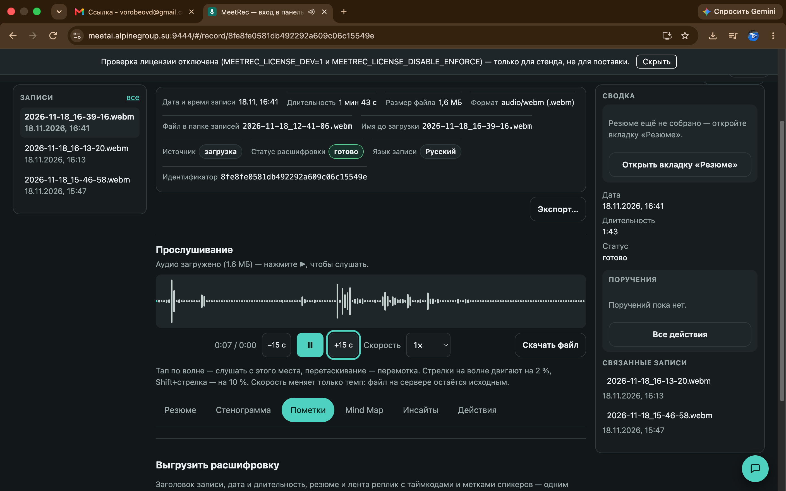
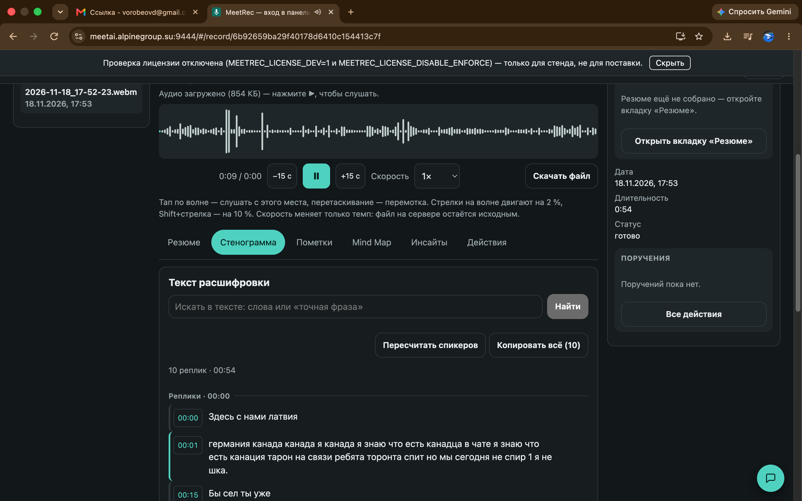
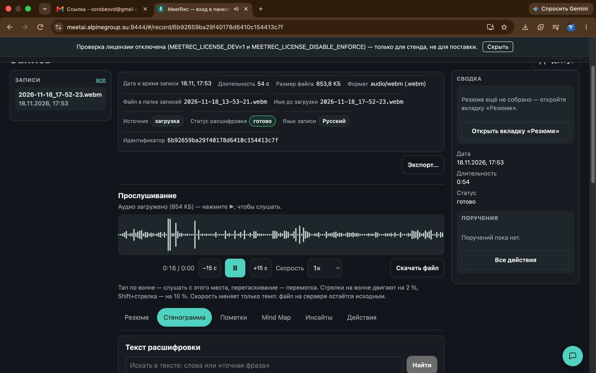
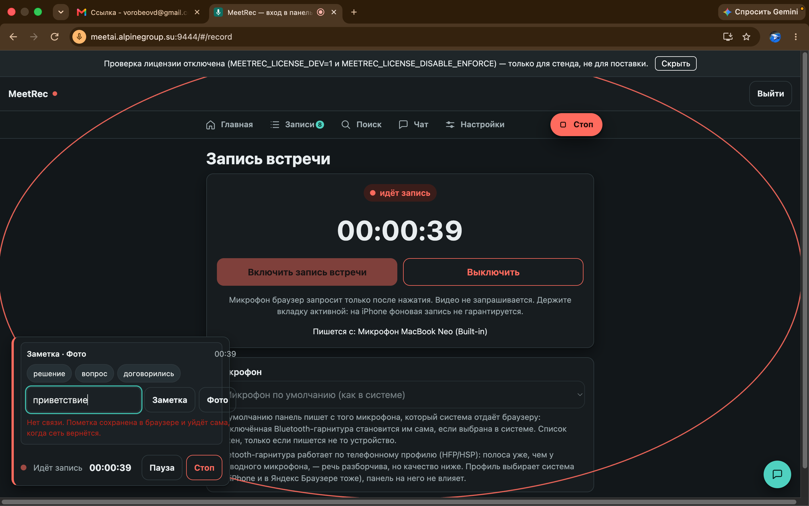
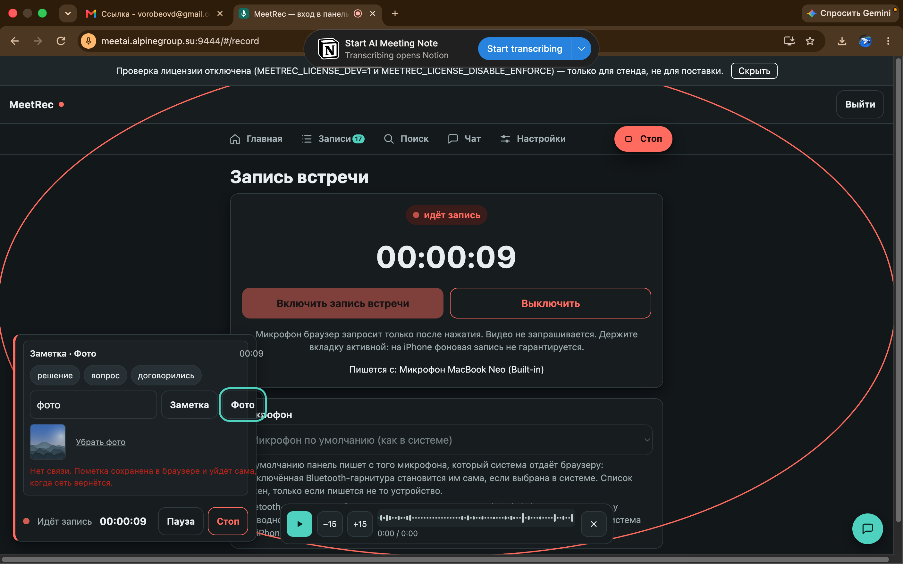

# Примеры баг-репортов (Проект: Веб-сервис для записи встреч)

*Ниже представлены выдержки из реального коммерческого проекта. Название клиента и конфиденциальные данные скрыты. Примеры демонстрируют подход к оформлению, детализацию шагов и анализ причин возникновения ошибок.*

---

## BUG-01: Критический сбой аудиоплеера (Blocker)

**Модуль:** Плеер (Карточка записи)
**Серьёзность:** Blocker
**Приоритет:** High
**Статус:** Open

**Окружение:** 
Браузер Google Chrome (версия 119+), ОС macOS/Windows.

**Шаги воспроизведения:**
1. Открыть любую карточку записи.
2. Нажать кнопку «Прослушать» (Play).
3. Попробовать поставить запись на паузу.
4. Попробовать перемотать запись кнопками «+15 с» / «-15 с» или кликом по звуковой волне.

**Фактический результат:** 
1. Аудио начинает воспроизводиться, но визуальный ползунок (волна) стоит на месте.
2. Кнопка «Пауза» не срабатывает (звук продолжает играть).
3. Кнопки перемотки «+15 с» и «-15 с» не работают.
4. Клик по волне не перематывает запись на нужное время.

**Ожидаемый результат:** 
Плеер должен работать синхронно с аудио: ползунок двигается, пауза останавливает звук, кнопки и клик по волне перематывают воспроизведение на заданное время. (Согласно инструкции пользователя).

**Причина (анализ QA):** Вероятно, рассинхронизация состояния HTML5-аудио элемента с React-компонентом плеера или ошибка в обработчике событий `timeupdate`.

**Доказательство (Скриншот):**

---

## BUG-02: Потеря данных (Невозможно сохранить заметку) (Critical)

**Модуль:** Запись встречи (Заметки)
**Серьёзность:** Critical
**Приоритет:** High
**Статус:** Open

**Шаги воспроизведения:**
1. Начать новую запись встречи.
2. Ввести текст в поле «Что запомнить?».
3. Нажать кнопку «Заметка».

**Фактический результат:** 
Текст заметки не сохраняется. Появляется сообщение об ошибке: **«Нет связи. Пометка сохранена в браузере и уйдёт сама, когда сеть вернётся»**, хотя интернет-соединение стабильно и другие запросы проходят успешно.

**Ожидаемый результат:** 
Пометка должна успешно отправляться на сервер, появляется сообщение «Пометка сохранена.». Данные не должны теряться.

**Доказательство (Скриншот):**

---

## BUG-03: Отсутствие валидации размера фото (Major)

**Модуль:** Запись встречи (Фото)
**Серьёзность:** Major
**Приоритет:** Medium
**Статус:** Open

**Шаги воспроизведения:**
1. Начать запись встречи.
2. Нажать кнопку «Фото» и выбрать снимок размером более 8 МБ.

**Фактический результат:** 
Система не присылает никаких предупреждающих сообщений о превышении размера файла. Фото либо не загружается молча, либо загружается с ошибкой (без текста).

**Ожидаемый результат:** 
Появляется четкое сообщение: «Фото больше 8 МБ. Уменьшите его или выберите другое.» (Согласно инструкции).

**Доказательство (Скриншот):**

---

## BUG-04: Вывод технической ошибки сервера в интерфейс чата (Утечка данных)

**Модуль:** Чат по записям (Security / UI)
**Серьёзность:** Major
**Приоритет:** High
**Статус:** Open

**Шаги воспроизведения:**
1. Перейти в раздел «Чат».
2. Задать любой вопрос по записям.
3. Нажать «Отправить».

**Фактический результат:** 
Вместо ответа от ИИ в чате появляется огромное красное сообщение с технической ошибкой: **«Недоступны обе модели — aitunnel и локальная: local: Сервис LLM недоступен (local): нет связи с http://127.0.0.1:8091/v1/chat/completions: [Errno 111] Connection refused; cloud: Ключ LLM не задан: добавьте MEETREC_AITUNNEL_KEY в .env...»**.

**Ожидаемый результат:** 
1. Система должна выдавать понятное пользователю сообщение (например: *"В данный момент сервис генерации ответов недоступен. Попробуйте позже"*). 
2. Внутренние технические данные (локальные IP-адреса, пути к файлам, названия переменных типа `MEETREC_AITUNNEL_KEY`) **не должны отображаться в клиентском интерфейсе**, так как это раскрывает внутреннюю архитектуру сервера (уязвимость).
