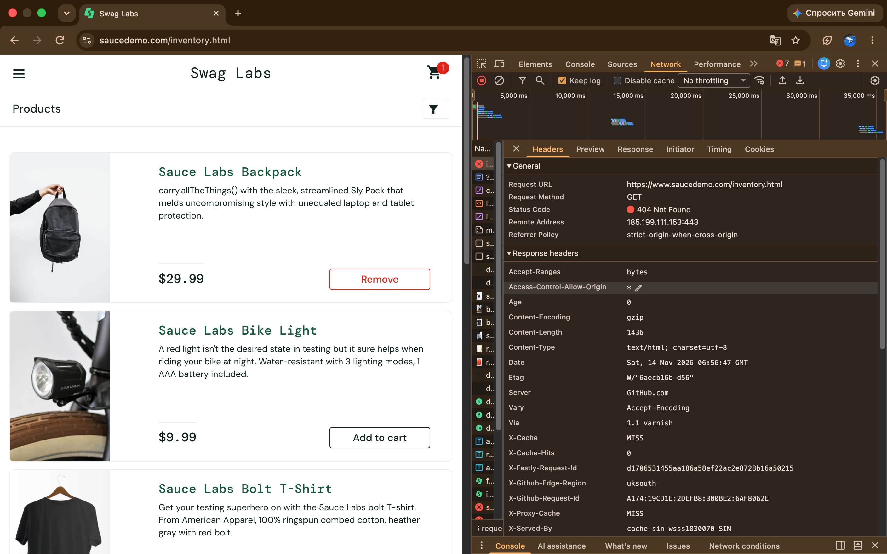
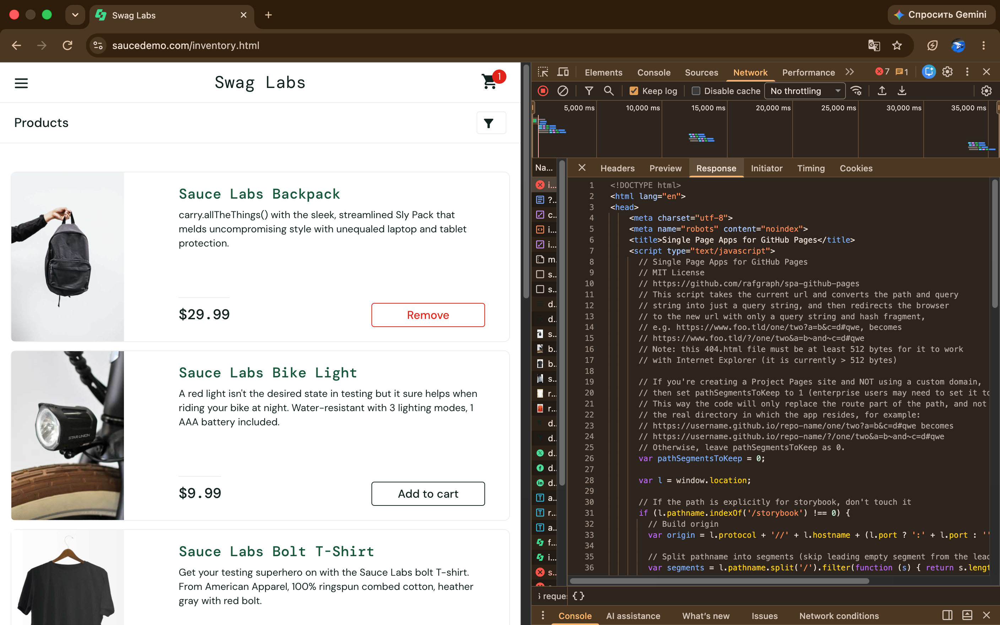
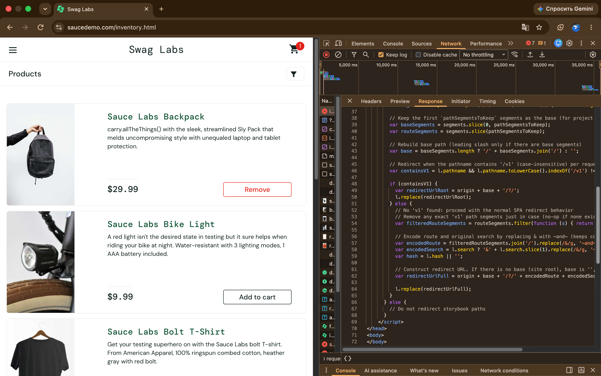
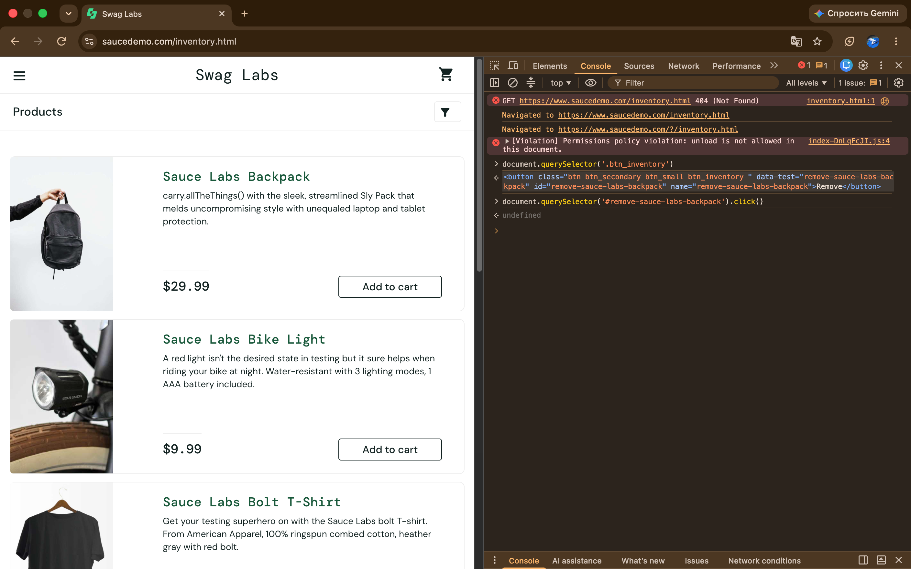

# BUG-16: Ошибка 404 (Not Found) при обновлении страницы каталога (inventory.html)

**Модуль:** Catalog / Routing
**Серьёзность:** Major
**Приоритет:** High
**Статус:** Open
**Дата:** 14.11.2026

**Окружение:** 
Браузер: Google Chrome 157.0.8103.79, Safari 26.5 (21624.2.5.11.4) ОС: macOS 26.5.1 (Tahoe)

**Шаги воспроизведения:**
1. Авторизоваться на сайте `www.saucedemo.com` под `standard_user`.
2. Открыть DevTools (F12) -> вкладка Network.
3. Находясь на странице каталога, нажать F5 (обновить страницу).

**Фактический результат:** 
Запрос `GET /inventory.html` завершается с ошибкой **404 Not Found**. В консоли (Console) появляются ошибки `Failed to load resource`. В ответе (Response) приходит стандартная страница ошибки хостинга (GitHub Pages), а не страница приложения. Пользователь теряет доступ к каталогу и вынужден заново авторизовываться.

**Ожидаемый результат:** 
Обновление страницы каталога должно возвращать статус `200 OK`. Сервер должен корректно обрабатывать роутинг SPA-приложения (Single Page Application) и возвращать главный файл `index.html` с последующей отрисовкой интерфейса через JavaScript без потери сессии.

**Доказательство:**

