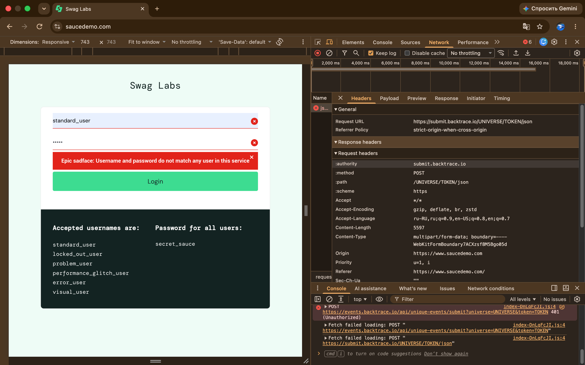
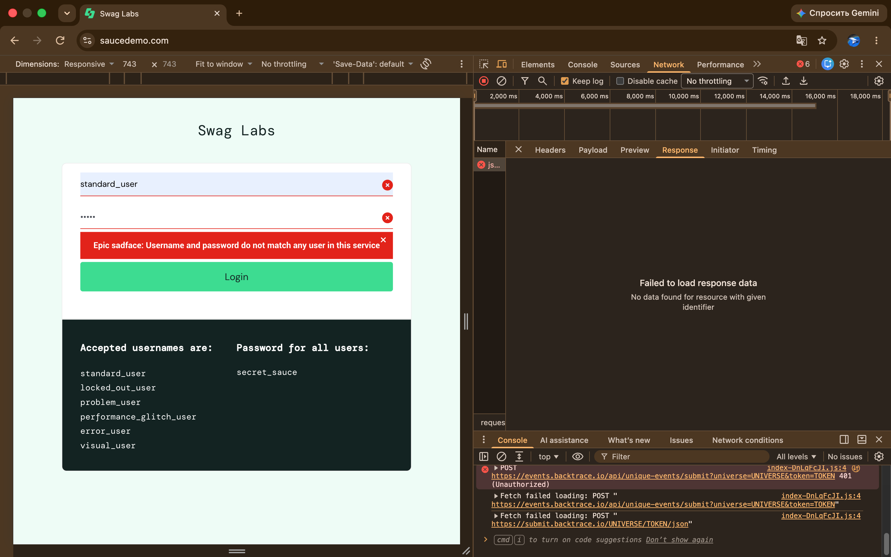
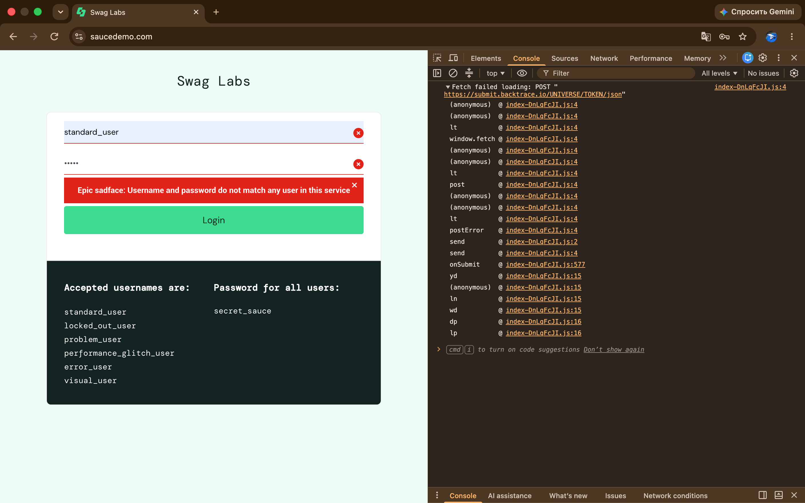

# BUG-15: Ошибка Fetch failed при отправке логов в backtrace.io при неверном пароле

**Модуль:** Login / Backend (Logging)
**Серьёзность:** Minor
**Приоритет:** Low
**Статус:** Open
**Дата:** 14.11.2026

**Окружение:** 
Браузер: Google Chrome,Safari ОС: macOS.

**Шаги воспроизведения:**
1. Открыть `www.saucedemo.com`.
2. Открыть DevTools (F12) -> вкладка Network (включить `Preserve log`).
3. Ввести логин `standard_user` и неверный пароль (например, `12345`).
4. Нажать кнопку "Login".
5. Перейти на вкладку Console.

**Фактический результат:** 
При неудачной попытке входа уходит POST-запрос на сторонний сервис `https://submit.backtrace.io/...`, который завершается со статусом `(canceled)` и не имеет ответа от сервера. В консоли браузера появляется красная ошибка `Fetch failed loading: POST`.
*(Примечание: Сам вход блокируется корректно, пароль на сервер не уходит).*

**Ожидаемый результат:** 
Система сбора логов (логирования) должна работать корректно (возвращать статус `200 OK` или `202 Accepted`) и не выдавать критических ошибок в консоль браузера при штатной проверке неверного пароля. Отказоустойчивость системы логирования не должна влиять на чистоту консоли.

**Доказательство:**

